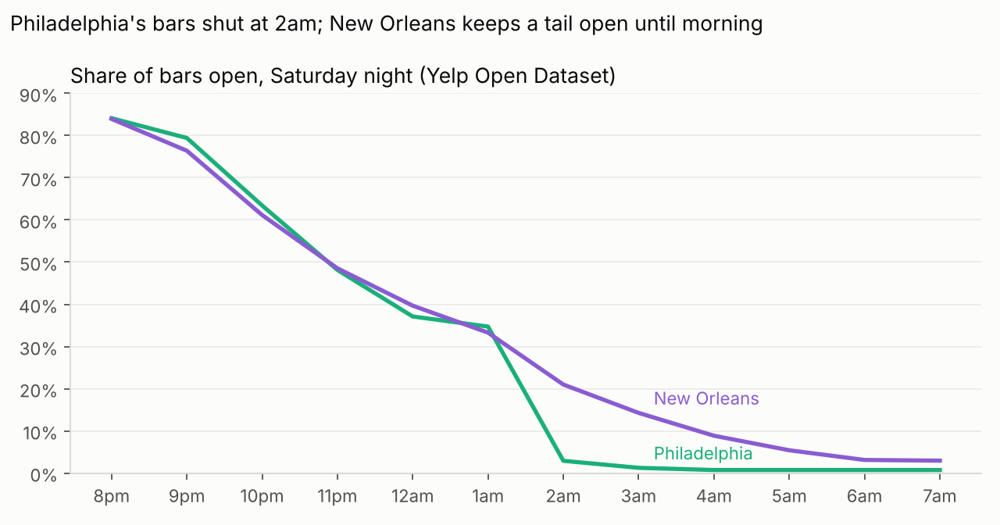
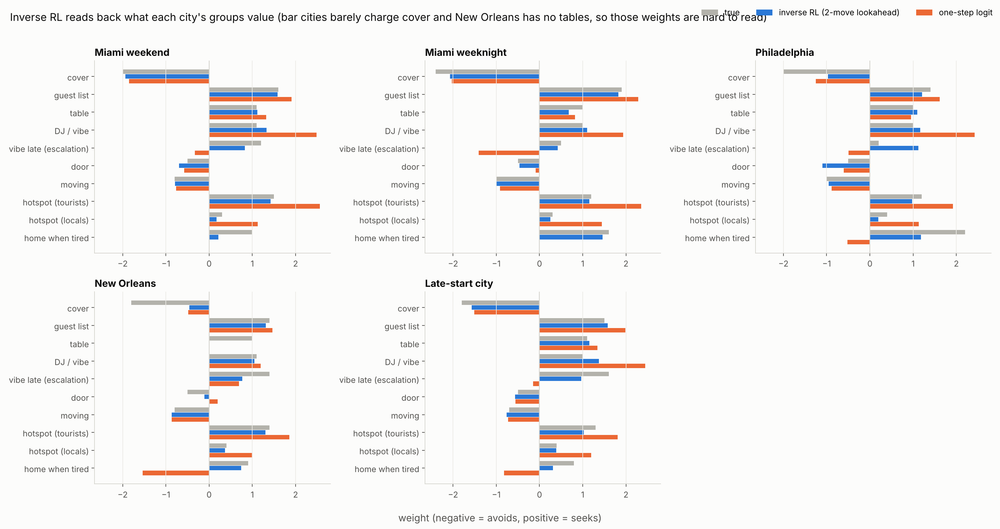
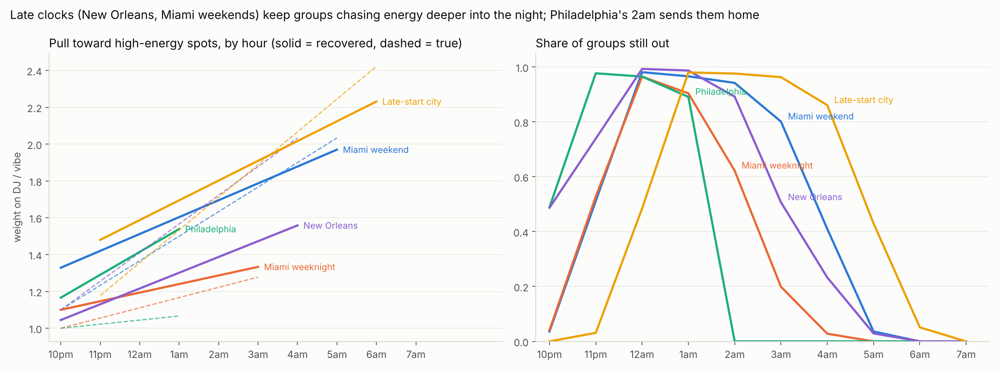
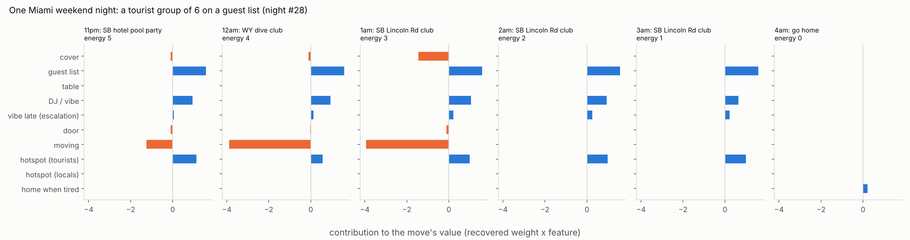

# funQ: the night clock

*An exercise in inverse reinforcement learning.* &nbsp;·&nbsp; [One-page summary (PDF)](funQ_night_clock_summary.pdf)

**How does a city's night clock change what groups value, and when?**

Miami doesn't close at 2am. Philadelphia does: by law, last call is at 2. New Orleans keeps a tail of bars open until morning. Same people, different clocks, so they make different choices. This project models how groups move through a night out, then uses **inverse reinforcement learning (IRL)** to read back what they value from where they actually went.

It uses two **real cities from the Yelp Open Dataset**: actual Philadelphia and New Orleans bars, with their real locations, price tiers, music and dancing tags, Saturday closing times, and when people check in. Miami is built from my own fieldwork, because Miami isn't in Yelp's data.

The underlying question is a general one: how people balance competing goals across contexts and over time, worked through on a subject I know from the inside.

---

## The big picture (read this first)

**IRL is ethnography in code.** An ethnographer doesn't ask people for their values. People are bad at reporting those. The ethnographer watches what they *do* and infers the norms that would make that behaviour sensible. IRL does the same thing: it looks at thousands of choices and asks *"what set of priorities would make these moves look reasonable?"*

Four layers:

1. **Real cities** (`yelp.py`): reads the Yelp files once and keeps 18 bars per city across 4 neighborhoods, plus each city's real "night clock" (the share of all its bars still open at each hour).
2. **A world** (`city.py`): Miami (18 venue archetypes from fieldwork) plus the two Yelp cities, and five **night clocks** that change when people start, what costs what, and when things close.
3. **People with known values** (`simulate.py`): 5,000 group nights out. I *set* what each kind of group values (the "true weights"), so the model can be checked against an answer key. A calibration step checks that the simulated crowds at the real bars rise and fall like their Yelp check-ins.
4. **The ethnographer** (`irl.py`): sees only the choices, never the true weights, and recovers them. It also tests whether groups **plan ahead or just react**.

### Running it

Requires Python 3.10+.

```
pip install -r requirements.txt
python yelp.py        # once: builds the Philadelphia / New Orleans tables from the raw Yelp files (about 3 seconds)
python simulate.py    # simulates 1,000 nights per clock, writes data/nights.csv (a few seconds)
python irl.py         # fits the weights and redraws the charts in figures/ (about 2 minutes on a laptop)
python onepager.py    # optional: rebuilds the one-page PDF summary
```

The Yelp data isn't included in this repo (Yelp's terms don't allow redistributing it). Download the [Yelp Open Dataset](https://www.yelp.com/dataset), put `yelp_academic_dataset_business.json` and `yelp_academic_dataset_checkin.json` in `data/yelp/`, and run `yelp.py` once. Without it, `simulate.py` and `irl.py` still run on the three Miami-based clocks and skip the two Yelp cities.

---

## How a group decides

Every hour from 10pm a group picks one option: **stay** where they are, **move** to another open venue, or **go home**. Each option is scored on 10 things:

| feature | what it means |
|---|---|
| cover | what getting in costs, *relative to what this group can comfortably spend* |
| guest list | being on a promoter's list at this venue |
| table | having a table / bottle service here |
| DJ / vibe | how much energy the room has *right now* (each venue peaks at its own hour) |
| vibe late (escalation) | the same energy, but counting more as the night goes on, so groups escalate |
| door | how hard the door / dress code is to get past |
| moving | the cost of leaving and getting somewhere (a fixed hassle plus distance) |
| hotspot (tourists) / hotspot (locals) | the pull of the famous spots, measured separately for each kind of group |
| home when tired | how good bed sounds, rising as energy drops |

Groups choose **noisily**, not perfectly (medium-low rationality), and look only **1–2 moves ahead**. Energy drains every hour, faster at high-energy spots in some cities. At zero energy the group crashes and goes home.

### Access paths instead of demographic labels
Miami nightlife sorts people hard by money and gender: early tickets skew toward people with less money, tables toward wealthy men, and promoters mostly steer women. Instead of tagging individuals by gender or income, the model captures this through the **access path** a group gets in on: **early ticket, late ticket, guest list, or table**. That keeps the model about *how the system sorts people*, which is what we can observe and defend, not about labelling individuals. Each group has an **anchor**, whoever holds the table, then the promoter connection, then the budget, and the anchor's path sets the group's options. In the bar cities, most people just walk in (85% hold a plain "early ticket" path).

### How a Yelp bar becomes a venue
| model field | from Yelp | rule |
|---|---|---|
| location | latitude / longitude | km from the city centre; 3 km ≈ one Miami unit of travel hassle |
| neighborhood | 4 clusters by location (k-means) | named by the most common ZIP code |
| closing time | Saturday hours | "16:0-2:0" = 4pm to 2am; "0:0-0:0" = open 24 hours |
| vibe | Dance Clubs / GoodForDancing, Music (DJ or live), Ambience (trendy / hipster), late check-in share | weighted sum, 0–1 |
| peak hour | share of check-ins after 10pm | venues busy late peak later (11pm to 2am) |
| popularity | review count | rank within the city |
| cover, tables, promoters | *not in Yelp* | from price tier and dancing: most bars charge $0–10, tables only at pricey dance clubs |

Venues were picked from bars open at 10pm and past midnight with 30+ reviews, bars before restaurants-with-a-bar. Hotels and taxi listings were dropped (they show up as "24 hours").

---

## The five night clocks

| clock | source | start | closings | energy |
|---|---|---|---|---|
| **Miami weekend** | fieldwork | 10pm (early tickets) to midnight | 2am to "never" (24h club, warehouse until morning) | the party doesn't stop |
| **Miami weeknight** | fieldwork + published listings | 10pm to midnight | weekend-only clubs closed | hype drains extra (work tomorrow) |
| **Philadelphia** | Yelp | 10–11pm | real Saturday hours: 16 of 18 bars close at 2am, 2 at midnight | hype drains extra |
| **New Orleans** | Yelp | 10pm to midnight | real Saturday hours: midnight to 6am, one bar open 24h | the party doesn't stop |
| **Late-start city** (Madrid-style) | fieldwork / published norms | 11pm to 1am | Miami venues, everything 2 hours later | the party doesn't stop |

The late-start city is kept because it costs almost nothing (it reuses the Miami venues) and it's the only clock where the night *starts* later rather than *ends* later.

---

## Results

### 0. The real night clocks (straight from Yelp, no model)


Share of *all* bars open at each hour of a Saturday night (962 Philadelphia bars, 610 New Orleans bars).

The two cities look identical until 1am, with about a third of bars open. Then Philadelphia falls off a cliff: **35% open at 1am, 3% at 2am**. New Orleans tapers: **21% at 2am, 14% at 3am, 9% at 4am, still 3% at 7am.** That's the 2am-law city vs the late city in one picture, from real data.

### 1. The ethnographer gets the values right


| night clock | avg error (IRL) | correlation with truth | avg error (one-step logit) | my ranking recovered? |
|---|---|---|---|---|
| Miami weekend | 0.19 | 0.97 | 0.66 | yes |
| Miami weeknight | 0.12 | 0.99 | 0.82 | yes |
| Philadelphia | 0.45 | 0.87 | 0.75 | no |
| New Orleans | 0.39 | 0.85 | 0.74 | no |
| Late-start city | 0.23 | 0.96 | 0.72 | no |

**My ranking of what drives the choice** (cover > guest list > table ≈ DJ > door) is recovered on both Miami clocks, where all those levers exist.

**The real cities are harder, and that's a finding, not a bug:** you can't learn how much people hate a cover charge in a city where bars barely charge one. Philadelphia and New Orleans bars charge $0–20, so the model sees almost no cover decisions and underestimates that weight (−1.0 and −0.5 vs −2.0 and −1.8 true). New Orleans has no venues with tables at all, so that weight reads as 0. In Philadelphia the 2am close leaves only about 3 hours of choices, so "vibe" and "vibe late" blur together (escalation is overestimated, 1.1 vs 0.2). Leaving out the levers that don't exist (guest list, table), New Orleans recovers at 0.91 correlation and Philadelphia at 0.85. **What a city's institutions allow decides what you can learn about the people in it.**

The one-step logit, a model that ignores the rest of the night, still gets things **backwards**: it says "home when tired" is *negative* in New Orleans, Philadelphia and the late-start city, and that escalation is negative in Miami. Groups were leaving because the clock ran out, and the logit can't see the clock.

### 2. The headline: the clock changes what people value, and when


- **Right:** share of groups still out. Philadelphia empties at **2am, exactly when its real bars close**. A Miami weeknight empties by 4am; New Orleans and a Miami weekend by 5am; the late-start city runs to 6am.
- **Left:** the pull toward high-energy spots, hour by hour (solid = recovered, dashed = true). The late-start city and Miami weekends escalate hardest; New Orleans keeps climbing until 4am. Philadelphia's recovered line climbs steeply but its true line is nearly flat. That's the blur from result 1: with only 3 hours of night, the model can't tell "likes vibe" from "likes vibe *later*."

### 3. Do groups plan or react?
Held-out log-likelihood (higher is better):

| night clock | react (0) | 1 move | **2 moves** | full night |
|---|---|---|---|---|
| Miami weekend | −1.486 | −1.485 | **−1.453** | −1.480 |
| Miami weeknight | −1.421 | −1.420 | **−1.362** | −1.408 |
| Philadelphia | −1.952 | −1.950 | **−1.912** | −1.928 |
| New Orleans | −1.989 | −1.988 | **−1.968** | −1.977 |
| Late-start city | −1.756 | −1.753 | **−1.732** | −1.743 |

2 moves wins everywhere. That's how the data was generated, so this is a **sanity check that the test works**, not a finding yet. On real trajectories (e.g. funQ check-ins), this table *becomes* the finding.

### 4. Calibration: do the simulated crowds look like Yelp?
Yelp has no individual nights, only when people check in. A check-in happens when you walk in, so I compare simulated **arrivals** at each real bar (10pm–7am) with its Yelp check-ins in the same hours:

| city | which bars draw the crowd (r) | when the city is busy (r) | bar × hour together (r) |
|---|---|---|---|
| Philadelphia | 0.70 | 0.74 | 0.56 |
| New Orleans | 0.15 | 0.52 | 0.33 |

Philadelphia lines up well. New Orleans gets the *timing* roughly right but not *which* bars. The model over-sends groups to late-closing bars (The Dungeon, d.b.a., Erin Rose) and under-sends them to famous early-closing ones (Carousel Bar, The Spotted Cat), which Yelp shows packed in the early part of the night. That says the escalation weight I set for New Orleans is too strong, or tourists' early-evening check-ins dominate Yelp. Next tuning step: lower New Orleans' escalation until this correlation rises.

### 5. One night, explained


A Miami weekend tourist group on a late ticket, hour by hour, showing which features pushed each move.

### Behaviour checks (from `simulate.py`)
- **Hours out per night:** New Orleans 4.9, late-start 4.8, Miami weekend 4.7, Philadelphia 3.3, Miami weeknight 3.3.
- **Hop vs settle** (chance the next hour is somewhere new): Miami weekend Wynwood 0.70 vs Brickell 0.39. Bar cities hop far more (0.74–0.88 across New Orleans), because walking into a bar costs nothing. Philadelphia's Northeast is the exception (0.36): its bars are spread out, so you stay put.
- **Herding:** on Miami weekends, tourists spend 63% of their time at the top-3 hotspots; locals spend 15%.
- **Runners:** 39% of nights have someone leave early on purpose.

---

## Where each assumption came from

**From my own fieldwork in Miami nightlife:**
- The night clock: pregame 8–10pm, arrival 10pm–12am depending on ticket tier, 3–4 hours in the club, the crash about an hour before or after the late venues close, otherwise 3–5am.
- Cities differ: Miami and Berlin don't stop; Gainesville and NYC wind down by 2am; Madrid goes out at 11pm or later.
- Neighborhoods: Wynwood hops; Brickell settles into 1–3 spots, priced highest and open late; South Beach goes all night at medium-low prices; Downtown is either the after-hours stop or "get there and stay there."
- Prices: early tickets $20–60, later entry $150 up to about $1,000, tables $4k–$30k.
- The ranking of what drives choices: cover > promoters/guest list > tables ≈ DJ > dress code/door.
- Stratification by money and gender across ticket tiers, promoters and tables (modelled as access paths).
- Locals spread out; tourists pile into the hotspots.
- The anchor: whoever has the promoter connection or the budget steers the group.
- Groups stay together and escalate toward higher energy until they crash; about 2 in 5 nights someone leaves early on purpose.
- People look 1–2 moves ahead; choices are fairly random (medium-low rationality).

**From the Yelp Open Dataset (Philadelphia and New Orleans):**
- 36 real bars: names, locations, neighborhoods, price tiers, dancing / music / ambience tags, review counts.
- Real Saturday closing times, for those bars and for the citywide "share open by hour" chart.
- Check-ins by hour, used for each bar's peak hour and late-night vibe, and as the calibration target.

**From published venue information:**
- Downtown Miami has a 24-hour club open Wednesday through Monday, and a warehouse club whose parties run into the morning.
- Miami weeknights are active: Monday industry nights and long-running Tuesday parties.

**Modelling choices I made:** the Miami venue list (18 archetypes, not real businesses), the true weights, the energy scale, the fixed "moving" hassle, and the rules that fill in cover, tables and promoters for Yelp bars.

---

## Files

```
.
├── yelp.py                         # raw Yelp files -> small venue CSVs
├── city.py                         # worlds, night clocks, features, planner
├── simulate.py                     # simulated nights out with known values
├── irl.py                          # recovers the values, draws the charts
├── onepager.py                     # builds the PDF summary
├── funQ_night_clock_summary.pdf
├── requirements.txt
├── data/                           # generated CSVs and raw Yelp files (git-ignored)
└── figures/                        # charts shown in Results
```

- `funQ_night_clock_summary.pdf`: one-page summary of the project and its main results.
- `onepager.py`: builds that PDF from the figures in `figures/`.
- `yelp.py`: reads the raw Yelp files once. Parses hours (overnight closes, 24h), converts check-in times from UTC to local, filters open bars and clubs, clusters each city into 4 neighborhoods, and picks 18 venues. Writes `data/yelp_philadelphia_venues.csv`, `data/yelp_new_orleans_venues.csv` and `data/yelp_open_by_hour.csv`.
- `city.py`: the worlds (Miami from fieldwork; the Yelp cities from those CSVs), the five night clocks, the 10 features, and the planner (`q_values`): soft planning with a limited lookahead that also returns how each choice's value changes with each weight, which makes fitting exact.
- `simulate.py`: generates 1,000 nights per clock. Writes `data/nights.csv` and `data/venues.csv`, prints the behaviour checks and the Yelp calibration.
- `irl.py`: fits the weights by maximum likelihood (Adam) with light L2 and early stopping. Fits 4 lookaheads per clock, scores them on 20% held-out nights, and draws the 4 charts.

## Settings you can tune

| setting | where | current | meaning |
|---|---|---|---|
| `TEMPERATURE` | city.py | 1.5 (medium-low) | how noisily people choose |
| `HORIZON` | city.py | 2 | moves ahead people look when simulated |
| `L2` | irl.py | 0.001 (light) | pull toward zero. 0.01 already shrinks weights noticeably at this data size |
| `PATIENCE`, `CHECK_EVERY` | irl.py | 8 checks, every 10 steps | early stopping: quit once validation stops improving |
| `NIGHTS_PER_CONTEXT` | simulate.py | 1000 | more nights, sharper recovery |
| `VENUES_PER_CITY` | yelp.py | 18 | bars kept per real city (every city must match Miami's 18) |

## Limitations

- **The people are simulated.** Yelp gives real venues and real busy hours, but no individual nights out. The method is proven against an answer key and the world is calibrated to real data, but none of the weights are findings about real people yet.
- **Check-in bias.** People check in when they arrive, often early in the evening, and rarely at 2am. So check-ins are used only as *relative* busyness by hour, never as crowd counts.
- **Time zones are approximate.** Yelp timestamps are UTC; I convert with standard time (Philadelphia −5, New Orleans −6) and ignore daylight saving, so summer check-ins are off by an hour.
- **The Yelp snapshot predates 2026.** Some bars have closed or changed hours since. `is_open` is Yelp's flag at snapshot time.
- **Miami isn't in Yelp.** The Miami side rests on my fieldwork and published listings; its venues are archetypes.
- **Cover, tables and promoters in the Yelp cities are inferred** from price tier and dancing, not observed.
- **New Orleans calibration is weak on *which* bars** (r = 0.15); see result 4.
- **"Home when tired" is the hardest weight to recover** where most nights end at closing time rather than by choice (Miami weekend 0.2 vs 1.0 true).
- **Rationality and lookahead are assumed known** when fitting. Real data would fit them too.

## Data attribution

Philadelphia and New Orleans venue data: **Yelp Open Dataset** (yelp.com/dataset), used under Yelp's dataset terms for educational, non-commercial use. No Yelp data is redistributed here; the scripts rebuild everything from your own download.

---

## Open design decisions

| # | decision | current choice | alternative |
|---|---|---|---|
| 1 | Real cities | Philadelphia (2am law) vs New Orleans (late) | Nashville or Tampa (Ybor City), the closest Yelp city to Miami |
| 2 | Venue pick | 18 per city, 4 neighborhoods, bars before restaurants, 30+ reviews | only "Dance Clubs" (closer to Miami, but too few per city) |
| 3 | Cover in bar cities | $0–20 from price tier and dancing | ask locals / scrape event pages for real covers |
| 4 | New Orleans escalation | 1.4 (true weight) | lower it until calibration (result 4) improves |
| 5 | Lookahead | 2 moves | 1 move (pure reaction) |
| 6 | Rationality | 1.5, medium-low | 1.0 (more deliberate) |
| 7 | Regularization | light (0.001) | 0 (sharper but noisier) |
| 8 | Access paths | 4 paths; bar cities 85% walk-in | let mixed groups split by path |
| 9 | Tourist share | Miami weekend 50%, New Orleans 50%, Philadelphia 20% | from real data, e.g. hotel occupancy |
| 10 | The runner | logged on 2 in 5 nights; group carries on | runner changes group size / table cost per person |
| 11 | Late-start city | kept (reuses Miami venues) | drop it to keep the story to real cities + Miami |
| 12 | Nights per clock | 1000 | 2000 (slower, sharper; would help the bar cities) |
